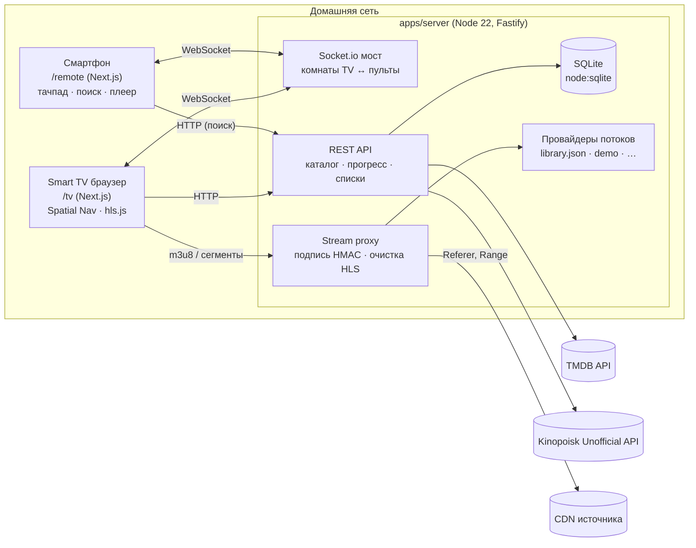
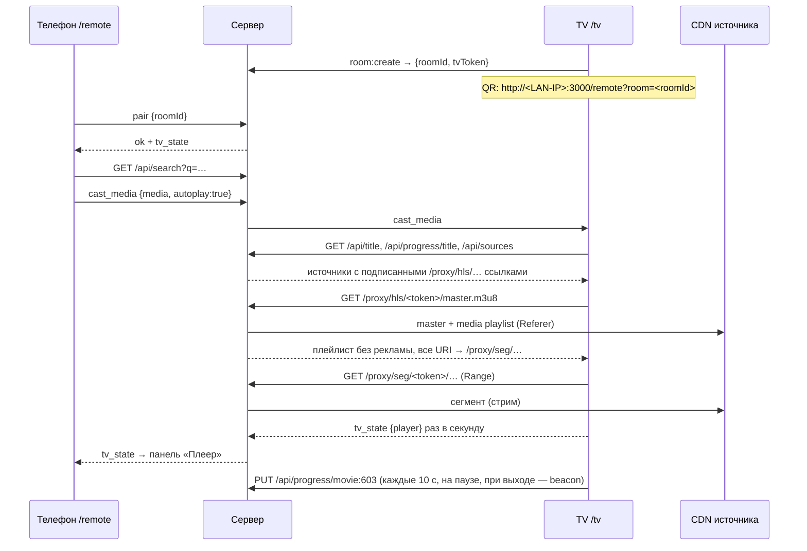

# Архитектура «Кинозала»

## Компоненты



| Слой | Где | Ответственность |
|---|---|---|
| Протокол | `packages/shared` | Типы событий Socket.io, zod-схемы, `MediaRef`, ключи прогресса — общие для сервера и клиентов |
| WebSocket-мост | `apps/server/src/socket` | Комнаты, сопряжение по QR, ретрансляция команд, rate-limit, переподключение TV по секретному токену |
| Метаданные | `apps/server/src/metadata` | TMDB (ru-RU) + Кинопоиск (рейтинги, русские рецензии), TTL-кэш, демо-каталог без ключей |
| История | `apps/server/src/db.ts` | Таймкоды, «Просмотрено» (≥ 90 % или вручную), «Избранное», «Посмотреть позже» |
| Стриминг | `apps/server/src/streaming` | Провайдеры → подписанные прокси-ссылки → очистка плейлиста → потоковая отдача сегментов |
| TV UI | `apps/web/components/tv`, `lib/spatial` | 10-foot интерфейс, пространственная навигация, плеер, виртуальный курсор |
| Пульт | `apps/web/components/remote` | D-pad, тачпад (жесты/мышь), ввод текста, cast, управление плеером |

## Протокол сокета

| Событие | Направление | Назначение |
|---|---|---|
| `room:create` | TV → сервер (ack) | Новая комната: `roomId` (в QR) + `tvToken` (секрет TV) |
| `room:resume` | TV → сервер (ack) | Вернуться в комнату после перезагрузки/обрыва (пульты не теряются) |
| `pair` | пульт → сервер (ack) | Подключение по `roomId`; в ответе — последнее `tv_state` |
| `remote_key` | пульт → TV | `up/down/left/right/enter/back/home/play_pause` — те же действия, что у пульта TV |
| `pointer_move` / `pointer_click` / `pointer_scroll` | пульт → TV | Виртуальный курсор (volatile: устаревшие дельты не копятся) |
| `text_input` | пульт → TV | Текст поиска посимвольно; `submit` — перейти к результатам |
| `player_control` | пульт → TV | `play/pause/toggle/stop/seek_relative/seek_absolute/volume/mute` |
| `cast_media` | пульт → TV | Открыть тайтл и (по умолчанию) сразу запустить плеер |
| `tv_state` | TV → пульты | Экран, строка поиска, состояние плеера (раз в секунду во время просмотра) |
| `room:peers`, `room:tv_presence`, `room:closed` | сервер → все | Кто подключён, TV offline/online, комната закрыта |

Сервер валидирует каждое событие zod-схемой из `@movie/shared` и ретранслирует его строго по ролям:
команды пульта получает только TV своей комнаты, `tv_state` — только пульты.

## Сценарий «Смотреть на ТВ» с телефона



## Очистка HLS от рекламы

`apps/server/src/streaming/hls-cleaner.ts` — чистая функция без I/O, покрыта тестами.

1. **SCTE-35**: сегменты между `#EXT-X-CUE-OUT` и `#EXT-X-CUE-IN`.
2. **URL-паттерн**: `/ads/`, `/promo/`, `vast`, `preroll`, `casino` и т.п. (расширяемо).
3. **Чужой хост**: короткий (≤ 90 с) discontinuity-блок целиком с другого хоста.
4. **Другой шаблон пути**: короткий блок с другим каталогом сегментов на том же CDN.
5. **HLS Interstitials**: удаляются `EXT-X-DATERANGE` класса `com.apple.hls.interstitial`.

Предохранители: эвристики 3–4 не применяются, если «реклама» составила бы больше половины;
для live-плейлистов вырезается только ведущая реклама (иначе ломается `MEDIA-SEQUENCE`).
`EXT-X-KEY`/`EXT-X-MAP` переносятся на первый оставшийся сегмент, `MEDIA-SEQUENCE` и
`DISCONTINUITY-SEQUENCE` корректируются, лишние `#EXT-X-DISCONTINUITY` схлопываются.
Вырезанные сегменты сервер даже не скачивает — клиент о них не знает.

Почему прокси, а не фильтр в браузере: TV получает уже чистый плейлист и сегменты с того же
origin — нет CORS-проблем, нет чужого JS на странице, а Referer/Origin, которые требуют CDN,
выставляет сервер.

### Безопасность прокси

Прокси ходит только по URL, которые выдал сам сервер: в путь зашит `base64url(JSON{u, r, e})`
и HMAC-SHA256 (`PROXY_SECRET`). Подделать адрес (например, `http://169.254.169.254/`) нельзя,
ссылки протухают через 12 часов. Принимаются только `http(s)`.

### Экстрактор embed-страниц

`streaming/extractor.ts` скачивает страницу плеера на сервере и достаёт из неё **только**
ссылки на `.m3u8`/`.mp4` (`<video>/<source>`, JSON-конфиги, формат качеств/озвучек Playerjs),
отбрасывая скрипты, iframe-ы, VAST-ссылки. HTML источника никогда не попадает в браузер TV,
поэтому всплывающие окна, редиректы и майнеры технически не могут выполниться.
Вложенные iframe проходятся только для того же хоста или хостов из `EXTRACTOR_ALLOWED_HOSTS`.

### Провайдеры потоков и цепочка фоллбеков

```ts
interface StreamProvider {
  id: string;
  name: string;
  resolveMedia(params: ResolveParams, signal?: AbortSignal): Promise<ProviderStream[] | null>;
}
// ResolveParams: kind, tmdbId, imdbId?, title?, originalTitle?, year?, season?, episode?
// ProviderStream: url (m3u8/mp4), type, quality?, label? (озвучка), referer?
```

`ProviderManager.resolveWithFallback(params, { preferred?, exclude? })`
(`streaming/provider-manager.ts`):

1. Провайдеры опрашиваются **последовательно** в порядке приоритета (`preferred` — первым).
2. `null`/`[]` → статус `empty`, исключение → `error`, нет ответа за `timeoutMs` → `timeout`; переходим к следующему.
3. Первый, вернувший потоки, — `ok`; остальные остаются `untried` (их не дёргаем зря).
4. Ответы фильтруются (только `http(s)` + `hls`/`mp4`) и кэшируются: найденное — 10 мин, «нет» — 1 мин, ошибки не кэшируются.

`/api/sources` группирует потоки активного провайдера в источники «озвучка × качества» и
возвращает статусы всех провайдеров для переключателя. Если поток упал уже в плеере
(манифест не грузится, сеть/декодер не восстановились), клиент повторяет запрос с
`exclude=<упавшие>` и продолжает с той же секунды на следующем провайдере.

| Провайдер | Файл | Сопоставление |
|---|---|---|
| `LibraryProvider` | `providers/library.ts` | `library.json`, ключ `movie:<tmdbId>` / `tv:<id>:sXeY` |
| `JellyfinProvider` | `providers/jellyfin.ts` | индекс библиотеки по `ProviderIds.Tmdb/Imdb` (кэш 10 мин) → название + год ±1; серия — `/Shows/{id}/Episodes?season=` |
| `GenericHttpProvider` | `providers/generic-http.ts` | шаблон URL, JSON `{streams:[…]}` или настраиваемый путь/поля; 404 = «нет тайтла» |
| `DemoProvider` | `providers/demo.ts` | открытые фильмы Blender |

Конфигурация — `data/providers.json`, сборка цепочки — `providers/registry.ts`. Адаптеры
под обход защиты конкретных пиратских балансеров в репозиторий намеренно не входят.

## Плеер: таймкоды, автопереход, громкость

- **`usePlaybackSync`** (`hooks/usePlaybackSync.ts`): `timeupdate` → `localStorage` не чаще раза в 5 с
  (`{position, duration, updatedAt, dirty: true}`); сервер — раз в 10 с во время просмотра и сразу на
  `pause`/`ended`/`seeked`/выходе; `pagehide`/`beforeunload` — `sendBeacon`. Успешный ответ снимает `dirty`.
  Неотправленные записи досылает `flushDirtyPlayback()` при старте приложения и на событии `online`,
  не перетирая более свежий прогресс с сервера. «Смотреть с MM:SS» берёт свежайшую из двух копий.
- **`AutoNextOverlay`**: по `ended` (если есть следующая серия) — размытый фон, кадр серии, кольцевой
  отсчёт 8 с; Enter/Play — сразу, Back — отмена (фокус переходит на «Следующая серия» в панели).
- **`VolumeHUD`**: ↑/↓ при скрытой панели — громкость ±5 %, индикатор исчезает через 2 с;
  громкость с телефона тоже его показывает. Space (код 32) — пауза.

## Пространственная навигация

`apps/web/lib/spatial` — движок без зависимостей от React + тонкий React-слой.

- **Геометрия** (`geometry.ts`): кандидат должен лежать по ту сторону текущего элемента (по центрам — устойчиво к `scale-105`); счёт = зазор по оси движения + штраф за смещение поперёк × 2.5, с бонусом за перекрытие проекций. Поэтому «вниз» из ряда постеров попадает в постер под текущим.
- **Секции** (`<FocusSection remember>`): ряд помнит последний фокус — возврат в ряд идёт на ту же карточку.
- **Ловушки** (`<FocusSection trap>`): модалка, плеер, меню. Фокус не выходит наружу; при закрытии возвращается туда, где был.
- **Стек обработчиков** (`useKeyHandler`, `useBackHandler`): верхний слой (меню → плеер → модалка → экран) получает клавишу первым.
- **Источники ввода**: клавиатура, коды пультов (`461` webOS Back, `10009` Tizen Return, `415/19` Play/Pause…), события `remote_key` с телефона, указатель (LG Magic Remote, мышь, виртуальный курсор) — всё сходится в `engine.dispatch()`.
- **Прокрутка**: сфокусированный элемент держится в «безопасной зоне» (12 % от края скролл-контейнера, 18 % от края экрана).

Интерфейс свёрстан в `rem` под 1920×1080; `useTvScale` пересчитывает `font-size` корня под фактическое разрешение браузера (у многих TV это 1280×720 или 960×540).

## Прогресс и «Просмотрено»

- Ключи: `movie:<id>`, `tv:<id>:s<S>e<E>`; `tv:<id>` — отметка всего сериала.
- Сохранение: каждые 10 с во время воспроизведения, на паузе/перемотке, при выходе (с ожиданием ответа) и `sendBeacon` при закрытии вкладки.
- Сервер ставит `watched` при `position/duration ≥ 0.9`; при пересмотре отметка не снимается, снять можно только явно.
- Карточка тайтла: «Смотреть с MM:SS» + «Смотреть заново»; для сериала — продолжение с последней начатой серии или следующей после досмотренной.
